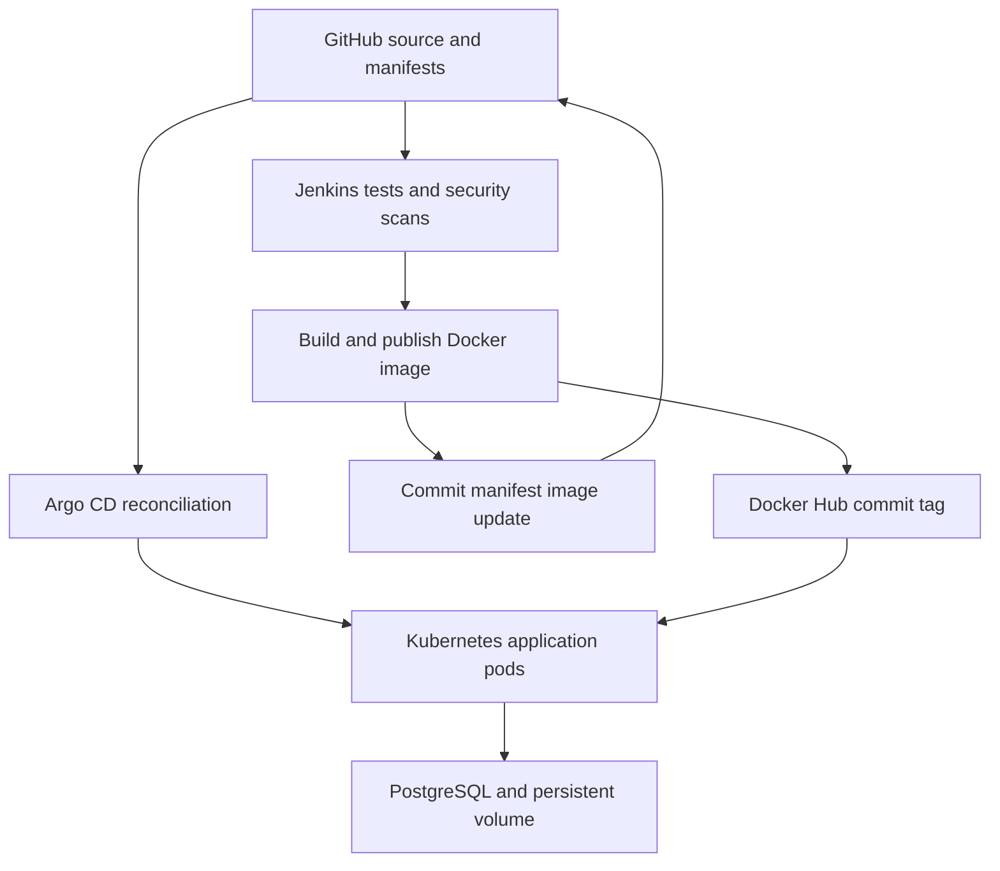

# TaskOps DevOps Capstone

TaskOps is a small task management application used to demonstrate a complete DevOps delivery workflow for a university lab. It combines a Python application and PostgreSQL database with automated testing, Docker images, Jenkins CI, Kubernetes deployment, Argo CD, infrastructure automation, monitoring, and centralized log collection.

**Student:** Ansh Kapoor  
**Repository:** [axdy02/devops-capstone](https://github.com/axdy02/devops-capstone)  
**Container images:** [axdy02/taskops on Docker Hub](https://hub.docker.com/r/axdy02/taskops)  
**Evidence date:** 27 November 2026  
**Implementation reviewed:** [`10b0071`](https://github.com/axdy02/devops-capstone/tree/10b0071e5884dec4d65feebd1b34720b25a96cac)

## Submission documents

| Document | Contents |
| --- | --- |
| [Capstone report PDF](docs/Capstone_Report.pdf) | Submission report with implementation, results, and screenshots |
| [Report in Markdown](REPORT.md) | Report readable directly on GitHub |
| [Evidence gallery](docs/EVIDENCE.md) | Numbered screenshots and captions |
| [Viva guide PDF](docs/Viva_Guide.pdf) | Short explanations and practice questions |
| [Viva guide in Markdown](docs/VIVA_GUIDE.md) | Searchable viva notes |
| [Execution runbook](docs/RUNBOOK.md) | Local startup, infrastructure, CI/CD, monitoring, and troubleshooting |
| [Submission checklist](docs/SUBMISSION_CHECKLIST.md) | Upload steps and evidence checks |

## What the application does

The dashboard creates, displays, edits, and deletes tasks. Each task has a title, description, status, priority, and timestamps. Users can filter by status and view task counts. PostgreSQL stores the data; Flask serves the interface and JSON API through Gunicorn.

The application also exposes `/health/live`, `/health/ready`, `/api/version`, and `/metrics`. These endpoints let the delivery and monitoring tools check the running application. Five synthetic tasks can be loaded once using `SEED_DEMO=1`; no personal dataset is needed.

## DevOps workflow



Jenkins builds a commit-tagged image after tests and configured security checks. It publishes the image and commits its tag to the deployment manifest. Argo CD watches the `kubernetes/` directory and applies the desired state to the dedicated Minikube cluster. Application data lives in a PostgreSQL StatefulSet with persistent storage.

Prometheus and Grafana run in a separate Docker Compose stack. An ELK stack receives a batch of application logs from Kubernetes for inspection in Kibana. The [runbook](docs/RUNBOOK.md) explains the connections and local setup.

## Implemented components

| Area | Implementation |
| --- | --- |
| Application | Python, Flask, Gunicorn, HTML, CSS, JavaScript, PostgreSQL, Psycopg |
| Testing | Pytest unit and API/database integration tests; 46 passing cases in the supplied evidence |
| Containers | Multi-stage Dockerfile; separate runtime and test targets; Compose app/database stack |
| Infrastructure | Terraform invokes Minikube; Ansible configures namespaces, resource quotas, and limits |
| Kubernetes | Two app replicas, database StatefulSet, Services, ConfigMap, Secret references, probes, and a 2 GiB PVC |
| Continuous integration | Jenkins tests, Bandit, pip-audit, Docker build, Trivy report, image push, and GitOps update |
| Continuous delivery | Argo CD automatic synchronization and self-healing; pruning disabled |
| Monitoring | Prometheus scrapes Compose and Kubernetes endpoints; Grafana displays availability and request metrics |
| Logging | Kubernetes log snapshot sent through Logstash to Elasticsearch and viewed in Kibana |
| Release demonstration | Blue and Green deployments; Git-controlled Service selector switch and rollback |

The screenshots and result explanations are in the [report](REPORT.md) and [evidence gallery](docs/EVIDENCE.md). These are records of the lab execution, not a claim that services remain online continuously.

## Quick start for the application

Open Ubuntu in WSL2. Docker Desktop must be running with Ubuntu integration enabled. These commands start the local Compose application; the full Kubernetes setup is documented separately in the [runbook](docs/RUNBOOK.md).

```bash
git clone https://github.com/axdy02/devops-capstone.git
cd devops-capstone
```

If the repository is already cloned, use `cd ~/devops-capstone` instead. Create the local configuration only when it is absent:

```bash
if [ ! -e .env ]; then
  umask 077
  sed \
    -e "s/^POSTGRES_ADMIN_PASSWORD=$/POSTGRES_ADMIN_PASSWORD=$(openssl rand -hex 24)/" \
    -e "s/^DB_PASSWORD=$/DB_PASSWORD=$(openssl rand -hex 24)/" \
    .env.example > .env
fi

docker compose config --quiet
docker compose up --build -d --wait
docker compose ps
```

Open [TaskOps](http://localhost:8090). Keep `.env` local. Existing database passwords must continue matching the roles stored in PostgreSQL; do not regenerate them when resuming the lab.

Run the isolated test suite:

```bash
bash scripts/test.sh
```

The script creates temporary test resources and cleans up its own test volume. It does not use the application's normal database. Configuration details, sample API calls, and native development instructions are in the [runbook](docs/RUNBOOK.md).

## Local demonstration addresses

| Component | Address | Requirement |
| --- | --- | --- |
| Compose application | http://localhost:8090 | Main Compose stack running |
| Kubernetes application | http://localhost:8091 | Application port-forward running |
| Jenkins | http://localhost:8080 | Jenkins service running |
| Argo CD | https://localhost:8082 | Argo CD port-forward running |
| Prometheus | http://localhost:9090 | Monitoring stack running |
| Grafana | http://localhost:3000 | Monitoring stack running |
| Kibana | http://localhost:5601 | Logging stack running |

These are local demonstration addresses, not public deployment links.

## Repository guide

| Path | Purpose |
| --- | --- |
| `app/`, `wsgi.py`, `gunicorn.conf.py` | Application, interface, metrics, and logging |
| `migrations/`, `scripts/01-bootstrap.sql` | Database schema, sample data, and role initialization |
| `tests/`, `scripts/test.sh` | Automated tests and isolated runner |
| `Dockerfile`, `docker-compose.yml`, `compose.test.yml` | Container build and local execution |
| `Jenkinsfile` | Continuous integration and GitOps image updates |
| `infrastructure/terraform/` | Dedicated Minikube provisioning |
| `infrastructure/ansible/` | Namespace and resource policy configuration |
| `infrastructure/argocd/` | Argo CD Application definition |
| `kubernetes/` | Argo-managed application and database resources |
| `deployment-strategies/blue-green/` | Separate Green deployment manifest |
| `monitoring/`, `logging/` | Prometheus/Grafana and ELK configuration |
| `docs/` | Report, evidence, viva notes, and execution guide |

## Results and scope

The supplied evidence shows passing tests, successful image publication and GitOps deployment, manual scaling, replacement of an application pod, database persistence after pod recreation, monitoring, log ingestion, and a Service traffic switch followed by rollback.

This is a local educational prototype. The following distinctions matter when explaining it:

- Trivy findings are reported without blocking the build. Bandit uses severity and confidence thresholds. A successful pipeline does not mean every vulnerability was fixed.
- The database recreation exercise reused the same PVC. An independent backup and restore was not demonstrated.
- Blue-green routing was verified using build identities. Continuous zero-downtime measurement and an automatic metrics-triggered rollback were not demonstrated.
- Green is applied manually from a Git-tracked manifest outside Argo CD's watched directory. Both deployments share the database.
- Log forwarding is a batch snapshot. The Kubernetes metrics target is a Service endpoint, not separately labeled scraping of every replica.
- The application has no user login and is intended for a private demonstration. Single-node storage and a single database pod do not provide machine-failure high availability.

At the reviewed source revision, Blue uses image tag `538fca7` and Green uses `475ea41`. Both use application version `0.1.0`; the Git commit identifies the build. Future pipeline runs can change the Blue image tag.
