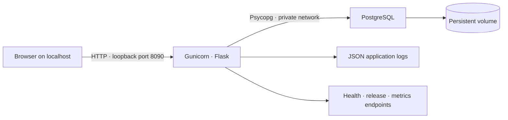

# TaskOps

TaskOps is a small, single-user task dashboard and the application foundation for a university DevOps capstone. It implements PostgreSQL-backed task management and exposes the health, release, metrics, and logging interfaces that later deployment stages can consume.

## Features and stack

- Create, view, edit, and delete tasks. Set pending, in-progress, or completed status and low, medium, or high priority.
- Filter by status and see total, pending, in-progress, and completed counts on desktop or mobile.
- Store task IDs, descriptions, priorities, statuses, and UTC timestamps in PostgreSQL 17 using Psycopg 3.
- Serve the same-origin HTML, CSS, JavaScript, and JSON API with Flask and Gunicorn on Python 3.13.
- Run Pytest against an isolated PostgreSQL database. Use Docker Compose for the app and database.

## Architecture



See [Architecture notes](docs/architecture.md) for the database lifecycle, observability, and deployment assumptions.

## Quick start in WSL2

Use Ubuntu in WSL2 with Docker Desktop running in Linux container mode and WSL integration enabled for Ubuntu. Git and Docker Compose v2 must be available in the Ubuntu shell. The default published port is 8090.

From the TaskOps project directory, typically `~/devops-capstone` in WSL, create a local environment file once. The commands preserve an existing `.env`.

```bash
if [ ! -e .env ]; then
  umask 077
  sed -e "s/^POSTGRES_ADMIN_PASSWORD=$/POSTGRES_ADMIN_PASSWORD=$(openssl rand -hex 24)/" \
      -e "s/^DB_PASSWORD=$/DB_PASSWORD=$(openssl rand -hex 24)/" .env.example > .env
fi
docker compose config --quiet
docker compose up --build -d
docker compose ps
```

Open [TaskOps on localhost](http://127.0.0.1:8090). To wait for health checks before proceeding, run `docker compose up --build -d --wait`.

Stop the stack and retain task data with:

```bash
docker compose down
```

The Compose project is named `taskops-capstone`. It publishes Flask only through IPv4 loopback. PostgreSQL is reachable by the app on the private Docker network. If 8090 is occupied, change `APP_PORT` in `.env` and use that port in the browser.

## Configuration

Compose reads `.env` from the project directory. For a native Python process, export variables in its shell. Keep both local passwords out of Git.

| Variable | Default | Purpose |
| --- | --- | --- |
| `APP_PORT` | `8090` | Published localhost port or native development port |
| `APP_TRUSTED_HOSTS` | `localhost,127.0.0.1,[::1],app` | Allowed HTTP hostnames. Keep `127.0.0.1` for Compose health probes |
| `POSTGRES_DB` | `taskops` | Database name |
| `POSTGRES_ADMIN_USER` | `taskops_admin` | Compose database bootstrap and maintenance login |
| `POSTGRES_ADMIN_PASSWORD` | Required by Compose | Password for the bootstrap account |
| `DB_USER` | `taskops` | Restricted application login |
| `DB_PASSWORD` | Required by Compose | Password for the application login |
| `DB_HOST` | `db` in Compose, `127.0.0.1` natively | Database host |
| `DB_PORT` | `5432` | Database port |
| `DB_SSLMODE` | `prefer` | Psycopg/libpq SSL mode |
| `APP_VERSION` | `0.1.0` | Release identifier, with optional prerelease or build suffix |
| `GIT_COMMIT_SHA` | Empty | Git revision, 7–64 hexadecimal characters |
| `BUILD_DATE` | Empty | ISO calendar date or UTC timestamp, such as `2026-03-01T12:00:00Z` |
| `LOG_LEVEL` | `INFO` | Python log level for structured application events |
| `SEED_DEMO` | `0`, enabled in the sample configuration | Set to `1` to insert five synthetic tasks once |

The official PostgreSQL container runs `scripts/01-bootstrap.sql` on first initialization of a fresh volume. It creates a separate application login and the `taskops` schema. The app applies numbered SQL migrations on its first database operation or readiness check. Set `SEED_DEMO=0` before first startup for an empty dashboard. Changing initialization credentials on an existing volume requires coordinating the PostgreSQL role password and `.env`.

For native development, first provision a **dedicated** PostgreSQL database and run `scripts/01-bootstrap.sql` as that database’s owner with `POSTGRES_DB`, `DB_USER`, and `DB_PASSWORD` exported. Then export the database connection settings for the app and run:

```bash
python3 -m venv .venv
source .venv/bin/activate
python -m pip install -r requirements-dev.txt
python wsgi.py
```

Use Python 3.13 or 3.14. The native command binds Flask’s development server to localhost. The Docker image uses Gunicorn.

## Tests and dependency audit

Run all unit, API, and PostgreSQL tests from WSL. The script uses its own Compose project, database and volume, then cleans up those resources. Its exit status can gate a future Jenkins build.

```bash
bash scripts/test.sh
```

Run just the unit suite in your Python environment with `python -m pytest -q tests/test_unit.py`. To run all tests with an independently provisioned PostgreSQL instance, create a dedicated database named `taskops_test`, set `TASKOPS_TEST_DSN` to a libpq connection string for a user with schema creation rights in that database, then run `python -m pytest -q`. Each test uses a randomly named schema.

Audit the pinned runtime and test packages on Linux:

```bash
python -m pip install pip-audit==2.10.1
python -m pip_audit --no-deps -r requirements-dev.txt
```

## HTTP API

A task has `id`, `title`, `description`, `status`, `priority`, `created_at`, and `updated_at`. Timestamps are ISO 8601 UTC strings. Send JSON with a title of 1–120 characters, up to 2,000 characters of optional description, a status of `pending`, `in_progress`, or `completed`, and a priority of `low`, `medium`, or `high`. The defaults are an empty description, `pending`, and `medium`.

| Method and path | Success response | Behavior |
| --- | --- | --- |
| `GET /api/tasks` | 200, `{"tasks":[...]}` | Newest ID first. Optional `?status=pending` or another valid status |
| `POST /api/tasks` | 201, task JSON and `Location` | Create a task |
| `GET /api/tasks/<id>` | 200, task JSON | Retrieve a task |
| `PUT /api/tasks/<id>` | 200, task JSON | Replace all editable fields. Omitted optional fields take their defaults |
| `DELETE /api/tasks/<id>` | 204, empty body | Delete a task |
| `GET /api/stats` | 200, counts | `total`, `pending`, `in_progress`, and `completed` across all tasks |
| `GET /api/version` | 200, release JSON | `name`, `version`, `git_commit`, and `build_date` |

Error bodies include `error.code`, `error.message`, and `request_id`. Invalid input returns 400, missing tasks 404, oversized input 413, a non-JSON request body 415, and PostgreSQL errors 503. All application responses include an `X-Request-ID` generated by TaskOps.

## Health, metrics, and logs

- `GET /health` returns status and release metadata. `GET /health/live` checks the HTTP process independently of PostgreSQL. The image health check probes liveness.
- `GET /health/ready` checks a fresh PostgreSQL connection and the task schema. It returns 503 when the dependency is unavailable. Compose uses this endpoint to report app health.
- `GET /metrics` returns Prometheus text exposition. It includes request and response counters, a latency histogram, error and task creation counters, the database availability gauge, and Linux worker CPU and memory metrics. Route labels contain route templates.
- Use `docker compose logs app` to read JSON request, startup, and shutdown events. Gunicorn can also emit its own server diagnostics. Metrics are local to the single Gunicorn worker and reset when it restarts.

## Repository layout

```text
app/                   Flask factory, routes, database, observability, dashboard
migrations/            PostgreSQL schema and optional demo seed
scripts/               Database bootstrap and isolated Compose test runner
tests/                 Pytest unit, API, and PostgreSQL integration tests
docs/                  Architecture notes
Dockerfile             Gunicorn runtime and separate Pytest image target
docker-compose.yml     App and PostgreSQL services
compose.test.yml       Override selecting the test image target
requirements*.txt     Pinned Python dependencies
gunicorn.conf.py       Worker and lifecycle logging configuration
wsgi.py                WSGI entry point and native development runner
.env.example           Local configuration template
```

## Security and limitations

TaskOps is intended for a private, single-user demonstration. Public exposure requires authentication, authorization, HTTPS, and further hardening. Local setup uses a restricted database role, a loopback-only app port, parameterized SQL, input and body-size limits, safe DOM rendering, and HTTP security headers. The application container runs as a non-root user with a read-only root filesystem.

The dashboard lists all matching tasks without pagination. Concurrent edits use last-write-wins semantics. The worker opens a fresh connection per database operation and supports small demonstration workloads. Later worker scaling will require a Prometheus aggregation strategy. Use separate secrets and delivery infrastructure for later environments.

## Capstone roadmap

1. Add Jenkins CI/CD, dependency and image scans, Jenkins Credentials, and Docker Hub image publishing.
2. Provision the demonstration environment with Terraform and Ansible, then deploy to Kubernetes or Minikube using Argo CD and Kubernetes Secrets.
3. Scrape metrics with Prometheus, build Grafana dashboards, and ingest application logs into Elasticsearch, Logstash, and Kibana.
4. Exercise Blue-Green or Canary releases, automated rollback, and PostgreSQL backup and disaster recovery.

The repository currently contains the application, PostgreSQL, and their local build and test configuration. The roadmap items are future capstone stages.
