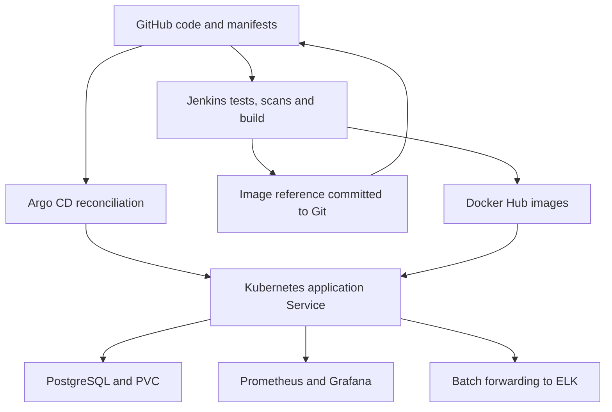

# TaskOps DevOps Capstone Report

**Student:** Ansh Kapoor  
**Evidence date:** 27 November 2026  
**Reviewed implementation:** [`10b0071`](https://github.com/axdy02/devops-capstone/tree/10b0071e5884dec4d65feebd1b34720b25a96cac)  
**Complete PDF:** [Capstone_Report.pdf](docs/Capstone_Report.pdf)

This report documents a small task application and the DevOps workflow demonstrated in the supplied evidence. It includes implementation, validation, security findings and scope limits. [All 71 screenshots](docs/EVIDENCE.md) are preserved and indexed.

## Problem and assignment scope

TaskOps is a small task-management application used to demonstrate a complete DevOps delivery workflow. A user can create, edit, filter and delete tasks, while the delivery platform tests the code, builds and publishes a container, updates Kubernetes manifests and observes the running application.

The capstone brief asks for version control, CI/CD, containers, Kubernetes, infrastructure automation, monitoring, logging, security and an advanced deployment strategy. It also requires an accessible project link and one PDF containing the problem, architecture, implementation, tests, screenshots and conclusions. [B1]

| Requirement | Implementation and evidence |
| --- | --- |
| Version control | GitHub source, incremental commits and final clean working tree. E01, E17, E34, E70-E71. |
| CI/CD | Jenkins tests, scans, builds and publishes; Argo CD reconciles the Git manifest. E43-E54. |
| Containers | Dockerfile and Compose application/database services. E02-E04. |
| Kubernetes | Two application replicas, Services, probes, PostgreSQL StatefulSet and PVC. E20-E29. |
| Infrastructure automation | Terraform starts Minikube; Ansible applies namespaces and policies. E09-E16. |
| Monitoring and logging | Prometheus and Grafana; batch log ingestion through ELK. E55-E62. |
| Security | Credentials, Secrets, non-root runtime and three scan tools. E19, E39-E46, E63. |
| Advanced deployment | Blue-green Service switching and Git-based rollback. E64-E69. |
| Recoverability | Application pod replacement, data retained across database pod recreation and traffic rollback. E28, E31-E33, E67-E69. |

> Scope: a working local college-lab implementation. The brief sets a production-readiness goal; the limitations section identifies the additional work required before public production use.

## System design and delivery flow

The same Flask application runs in a local Compose stack and in a dedicated Minikube cluster. Jenkins is a WSL system service. Prometheus, Grafana and ELK run as separate Compose services; Argo CD runs inside Kubernetes. [R1]



### How a change reaches the application

A developer pushes an application change to main. Jenkins checks out that revision, runs the isolated tests and security stages, builds an image tagged with the short Git SHA and publishes it to Docker Hub. Jenkins then commits the image reference to kubernetes/deployment.yaml. Argo CD watches that directory and reconciles the cluster. [R2, R3]

Kubernetes runs the application behind a stable Service. PostgreSQL uses a separate StatefulSet and persistent claim. ConfigMaps hold ordinary settings; a Secret supplies database credentials. Build metadata in /api/version connects a running image to its source commit. [R4]

> The main Service can select either Blue or Green. The monitoring Service and the current log-forwarding script select Blue independently of that traffic switch.

## Application and containerization

TaskOps uses Flask, Gunicorn and Psycopg with PostgreSQL 17. The interface uses HTML, CSS and JavaScript. Tasks have a title, description, status and priority. Five synthetic tasks provide repeatable demonstration data through migrations/seed_demo.sql. [R1]

| Interface | Purpose |
| --- | --- |
| /api/tasks | Create and list tasks; per-task routes retrieve, update and delete. |
| /api/stats | Return pending, in-progress, completed and total counts. |
| /health/live | Check the application HTTP process. |
| /health/ready | Check database connectivity and the task schema. |
| /api/version | Return application version, source Git SHA and build date. |
| /metrics | Expose application and process metrics in Prometheus format. |

### Container structure

The Dockerfile has a base stage, a test target and a runtime target. The runtime starts Gunicorn on container port 8090 as UID/GID 10001. Compose publishes the application at 127.0.0.1:8090; PostgreSQL remains on a private container network. Application runtime settings include a read-only root filesystem, a writable temporary directory and dropped Linux capabilities. [R1]

### Database lifecycle

The database bootstrap creates a separate administrative login and restricted taskops application role. The application manages numbered SQL migrations and optional seed data. A database advisory lock coordinates migration initialization when more than one application instance starts. Credentials are generated locally and kept outside Git. [R1]

### Observed result

The Compose services are healthy (E02), the dashboard shows five initial tasks (E03), and the health/API requests succeed (E07). The Kubernetes deployment later serves the same interface through port 8091 (E24-E25).

> The initial local image shows null build metadata. Later Jenkins-built images contain the source revision and build time; the report uses the Git SHA to distinguish builds that all retain version 0.1.0.

## Infrastructure automation

The lab runs on Ubuntu in WSL2 with Docker Desktop integration. A dedicated profile named taskops-capstone keeps this cluster separate from earlier lab profiles. The recorded cluster uses Kubernetes 1.37.0 and containerd 2.3.4. [E01, E11-E12]

| Tool or setting | Recorded configuration |
| --- | --- |
| Terraform | Version 1.14.0; built-in terraform_data resource with local-exec. |
| Minikube profile | taskops-capstone; Docker driver; containerd runtime. |
| Requested resources | 4 CPUs and 4096 MB in Terraform inputs. Effective host limits were not independently established. |
| Ansible | Local connection; applies namespace, ResourceQuota and LimitRange manifests. |
| Namespaces | taskops-dev and taskops-prod in the same cluster. |
| Production quota | 15 pods; requests: 2 CPU / 1536 MiB; limits: 3 CPU / 2560 MiB. |

### Terraform evidence

Initialization and validation succeed (E09). The plan adds one managed resource (E10). Apply starts Minikube and reports one resource added (E11). A separate health check shows the node Ready and cluster services Running; a repeat plan reports no changes (E12).

### Ansible evidence

The first playbook run creates the namespaces and policies with ok=6, changed=1 and failed=0 (E14). A repeat run returns changed=0 with no failures (E16), demonstrating idempotency for this configuration.

> Terraform stores the lifecycle of a command-driven terraform_data resource. Its no-change plan does not check every live Kubernetes object. The two namespaces provide logical organization within one local cluster. [R5, R6]

## Kubernetes orchestration and recovery

The application Deployment normally has two replicas. Its rolling-update policy allows one extra pod and zero unavailable replicas during an update. Startup/liveness probes use /health/live and readiness checks use /health/ready. This configures rollout safety; the screenshots do not measure continuous availability. [R4]

| Resource | Role in this project |
| --- | --- |
| Deployment taskops | Blue application replicas, image reference and health probes. |
| Service taskops | Stable internal port 8090; selector determines Blue or Green routing. |
| StatefulSet taskops-db | One PostgreSQL pod with stable identity. |
| PVC postgres-data-taskops-db-0 | 2 GiB ReadWriteOnce claim using the Minikube standard storage class. |
| ConfigMap / Secret | Non-sensitive settings / database credentials supplied to pods. |

### Scaling and application recovery

The application is manually scaled from two to four replicas (E27). Deleting one application pod causes the controller to create a replacement and restore four ready replicas (E28). The workload is then returned to two replicas (E29). This demonstrates manual horizontal scaling and controller recovery, rather than load-driven autoscaling.

### Database persistence

A unique Kubernetes Persistence Test record increases the total from five to six tasks (E31). The database pod is deleted and recreated while its existing claim remains Bound (E32). The application becomes ready again and still reports six tasks (E33). This demonstrates persistence across database pod recreation.

> This recovery check depends on the existing volume. It does not restore an independent backup or demonstrate recovery from loss of the laptop, cluster or volume. [R7]

## Jenkins pipeline and security results

The Jenkinsfile defines seven stages and polls source control with H/2 * * * *. Concurrent builds are disabled. Docker Hub and GitHub access use named Jenkins credentials; secret values are injected for the required steps. [R2]

| Stage | Work performed |
| --- | --- |
| Checkout | Read the source revision and derive the image tag. |
| Automated Tests | Run scripts/test.sh in an isolated Compose test project. |
| Security Scan | Run Bandit with severity/confidence thresholds and pip-audit on runtime requirements. |
| Docker Build | Build axdy02/taskops:<short SHA> with release metadata. |
| Container Scan | Run Trivy and save trivy-report.txt as an archived artifact. |
| Docker Hub Push | Publish the revision tag and latest with credential binding. |
| Update GitOps | Commit the application image reference to the deployment manifest. |

### What the scans actually show

**Bandit:** -ll -ii reports no issues meeting both selected thresholds. Five medium-severity, low-confidence B608 findings remain in the scan metrics; parameter values are bound separately in the SQL code. The filtered result is not a claim of zero findings. [E40; R2, R8]

**pip-audit:** the recorded requirements.txt scan finds no known vulnerabilities at that time. **Trivy:** the captured report lists 46 operating-system findings (44 high, 2 critical) and 5 Python-package high findings. These are 51 package-vulnerability entries, not necessarily 51 unique CVEs. [E41, E44-E46]

> Trivy uses --exit-code 0, so findings are report-only in this lab. Tests and the configured Bandit/pip-audit commands can fail the pipeline. The successful run does not establish a vulnerability-free image. [R2, R9]

## GitOps and blue-green deployment

Argo CD watches main at the kubernetes/ path and targets taskops-prod. Automatic synchronization and self-healing are enabled; automatic pruning is disabled. Jenkins updates Git, and Argo CD applies the desired Kubernetes state. [R3]

### Delivery evidence

Jenkins runs after the GitOps integration commit (E51-E52). The deployment-image change appears in Git (E53), and the next verification shows Argo CD Healthy/Synced with axdy02/taskops:475ea41 rolled out (E54). This connects the source change, image publication and deployed image.

| Release step | Observed result |
| --- | --- |
| Prepare environments | Blue and Green each have two replicas. Green uses image 475ea41. E64. |
| Select Green | The taskops Service selector becomes app=taskops-green. An in-cluster Service request returns Git SHA 475ea41. E65. |
| Reconcile Green routing | Argo CD reports Healthy and Synced at routing commit 83eef67. E66. |
| Request rollback | The Service selector is changed back to app=taskops and committed as 6b01807. E67. |
| Verify rollback | Argo CD is Healthy/Synced and the Service returns current Blue build 538fca7. E68-E69. |

### Interpretation

Both environments use the same database. Green is an existing older build used to demonstrate traffic routing, and Blue is updated by CI during the exercise. The verified rollback returns traffic to the Blue environment; it does not restore the initial Blue binary f341dbd. All these builds report version 0.1.0, so the Git SHA is the useful identity.

> Green is Git-tracked under deployment-strategies/blue-green/ and was applied manually outside Argo CD's watched path. Requests through the in-cluster Service establish routing; an existing port-forward can remain attached to its previously selected pod. No continuous zero-downtime or automatic metrics-triggered rollback test was performed.

## Monitoring and centralized logging

### Prometheus and Grafana

Prometheus scrapes every five seconds. The taskops job reaches the Compose application through host.docker.internal:8090, and taskops-kubernetes reaches the application through Minikube NodePort 30090. Both targets are UP in E59. Grafana uses Prometheus to display application status, database availability, total requests and average response time (E57-E58). [R10]

| Dashboard view | Query used in the demonstration |
| --- | --- |
| Application status | up{job="taskops"} |
| Database availability | taskops_database_available |
| Total requests | sum(taskops_http_requests_total) |
| Mean request time | sum(rate(taskops_http_request_duration_seconds_sum[1m])) / sum(rate(taskops_http_request_duration_seconds_count[1m])) |

The screenshot values are snapshots rather than load-test measurements. The Kubernetes target is a Service endpoint that can reach different Blue replicas; it is not independent per-pod scraping. Some dashboard queries combine jobs. The runbook records the manual Docker network connection and trusted-host settings needed for these targets.

### Elasticsearch, Logstash and Kibana

The logging stack uses ELK 8.17.3. The forwarding script reads the latest 100 lines from matching Blue application pods and sends them over TCP to Logstash. The json_lines codec handles newline-delimited JSON, and Elasticsearch stores the events in dated taskops-logs indices. Kibana supplies the search interface. [R11]

The captured count is 115 documents with zero failed shards for the count request (E61). Kibana displays application request records (E62). Server diagnostics also produce parse-failure entries, including a read-only-filesystem control-server message alongside successful HTTP responses.

> The collector is an on-demand batch script. Re-running it can duplicate recent events; it does not follow new pods continuously. The current monitoring Service and log selector stay on Blue during a Green traffic switch. Dashboard export/provisioning is not included in the original repository.

## Testing and observed outcomes

The evidence was captured during the student's run on 27 November 2026. The documentation review checks those screenshots against repository revision 10b0071. It does not represent a new execution of the application or a new scan on the student's laptop.

| Check | Observed outcome | Proof |
| --- | --- | --- |
| Automated tests | 46 tests pass. The source defines 31 unit and 15 integration cases after parametrization. | E04; R12 |
| Compose application | App and database healthy; UI and API respond. | E02-E07 |
| Infrastructure | Terraform apply succeeds; node Ready; repeated Ansible run changed=0. | E09-E16 |
| Kubernetes deployment | Two application replicas and one database pod ready; PVC Bound. | E20-E26 |
| Scaling | Two replicas become four and are returned to two. | E27-E29 |
| Pod replacement | A different application pod restores the desired replica count. | E28 |
| Persistence | Database becomes ready after pod recreation; six tasks remain. | E31-E33 |
| CI and registry | Jenkins execution and image publication complete successfully. | E43-E47 |
| GitOps delivery | Manifest revision, deployed image and Healthy/Synced state align. | E51-E54 |
| Observability | Both scrape targets UP; Grafana panels; 115 indexed log documents. | E58-E62 |
| Traffic rollback | Green build 475ea41 is served, then Blue build 538fca7 is served. | E65-E69 |
| Final source state | Final push succeeds and working tree is clean at 10b0071. | E71 |

### Test coverage

Unit tests cover validation, defaults, limits, metadata, error responses, health and host checks. Integration tests exercise task CRUD, filtering, statistics, database constraints, migration/seed behavior, readiness and persistence through a new application instance. The test script creates its own temporary database environment. [R12]

## Security, recoverability and conclusions

### Controls demonstrated

The application uses a restricted database role, separate locally generated credentials, Jenkins credential binding and Kubernetes Secret references. The runtime runs as UID 10001 with a read-only root filesystem, no privilege escalation and all Linux capabilities dropped. Namespace quotas limit resource use, and .env is ignored by Git. E19, E21 and E63 show these controls. They do not establish secret encryption at rest or a complete secret-history audit.

### Practical limits of this lab

| Area | Scope established by this submission |
| --- | --- |
| Security findings | Trivy findings remain reported; Bandit uses confidence filtering. Dependency scanning is point-in-time. |
| Recovery | Pod replacement and same-volume persistence are demonstrated. Independent backup restoration and host/volume-loss recovery remain future work. |
| Availability | One Minikube node and one database replica are used. A load test and continuously measured zero downtime are not demonstrated. |
| Reproducibility | Source/configuration is versioned; some credentials, dashboards and Docker network setup are local steps documented in the runbook. Monitoring images use latest tags. |
| Observability | Metrics use a Service target; log shipping is a batch; the present selectors stay on Blue. |
| Public deployment | The application is a private single-user demo without public authentication/authorization or a production HTTPS endpoint. |

### Conclusion

TaskOps demonstrates the central DevOps workflow with a deliberately small application: versioned code, automated tests and scans, container publishing, declarative Kubernetes delivery, infrastructure automation, monitoring, centralized log inspection and a reversible traffic switch. The recovery exercises show how Kubernetes restores application replicas and preserves database data when a pod is recreated.

The result is a working educational platform with traceable evidence. Before public production use, the next steps are to review and remediate findings, verify an independent database restore, protect public access, make monitoring/log collection complete and export all local dashboard configuration. These are improvements beyond the demonstrated local run; this report does not claim they were completed.

## Execution and demonstration guide

Use the Ubuntu WSL shell for the commands below. Docker Desktop must be running with Ubuntu integration enabled. The complete bootstrap and restart instructions are provided in docs/RUNBOOK.md; the steps here resume the existing demonstration without replacing its database or credentials.

```bash
cd ~/devops-capstone
docker compose up -d --wait
minikube -p taskops-capstone start --driver=docker
kubectl --context=taskops-capstone -n taskops-prod get pods,svc,pvc
kubectl --context=taskops-capstone -n argocd get applications
```

Keep each required port-forward in a separate terminal. Restart it if a selected pod is replaced. For a traffic-switch check, query the Service inside the cluster as in E65/E69.

```bash
kubectl --context=taskops-capstone -n taskops-prod \
  port-forward service/taskops 8091:8090

# In another Ubuntu terminal for Argo CD
kubectl --context=taskops-capstone -n argocd \
  port-forward service/argocd-server 8082:443
```

| Interface | Local address |
| --- | --- |
| Compose application | http://localhost:8090 |
| Kubernetes application | http://localhost:8091 |
| Jenkins / Argo CD | http://localhost:8080 / https://localhost:8082 |
| Prometheus / Grafana | http://localhost:9090 / http://localhost:3000 |
| Kibana / Elasticsearch | http://localhost:5601 / http://localhost:9200 |

### A short demonstration sequence

Show the task dashboard and create a task. Show the recorded passing tests and Jenkins stages. Show Argo CD Healthy/Synced and the running pods. Open the Grafana dashboard and Kibana log view. Finish with the Green-switch and Blue-rollback evidence, explaining the Git SHA returned by the Service.

> The bootstrap uses locally supplied secrets and previously configured Jenkins/Argo CD access. A fresh machine requires those setup steps. No passwords or access tokens are included in this documentation.

## Evidence and references

[Evidence gallery and report page index](docs/EVIDENCE.md). Screenshot IDs refer to the original Word document order.

- **[B1]** Capstone assignment brief supplied by the student - image(20261126-091849).png; one PDF up to 25 MB plus an accessible GitHub/project link.
- **[E]** Student screenshot evidence - Devops Capstone evidence.docx; 71 unique screenshots retained in document order as E01-E71.
- **[R1]** [Application, containers and database](https://github.com/axdy02/devops-capstone/tree/10b0071e5884dec4d65feebd1b34720b25a96cac)
- **[R2]** [Jenkins pipeline implementation](https://github.com/axdy02/devops-capstone/blob/10b0071e5884dec4d65feebd1b34720b25a96cac/Jenkinsfile)
- **[R3]** [Argo CD Application](https://github.com/axdy02/devops-capstone/blob/10b0071e5884dec4d65feebd1b34720b25a96cac/infrastructure/argocd/application.yaml)
- **[R4]** [Kubernetes application and database manifests](https://github.com/axdy02/devops-capstone/tree/10b0071e5884dec4d65feebd1b34720b25a96cac/kubernetes)
- **[R5]** [Terraform implementation and resource reference](https://github.com/axdy02/devops-capstone/blob/10b0071e5884dec4d65feebd1b34720b25a96cac/infrastructure/terraform/main.tf)
- **[R6]** [Ansible playbook](https://github.com/axdy02/devops-capstone/blob/10b0071e5884dec4d65feebd1b34720b25a96cac/infrastructure/ansible/configure-cluster.yml)
- **[R7]** [Kubernetes persistent volumes](https://kubernetes.io/docs/concepts/storage/persistent-volumes/)
- **[R8]** [Bandit command options](https://bandit.readthedocs.io/en/latest/man/bandit.html)
- **[R9]** [Trivy report and exit-code options](https://trivy.dev/docs/latest/configuration/reporting/)
- **[R10]** [Monitoring configuration](https://github.com/axdy02/devops-capstone/blob/10b0071e5884dec4d65feebd1b34720b25a96cac/monitoring/prometheus.yml)
- **[R11]** [Batch log forwarding](https://github.com/axdy02/devops-capstone/blob/10b0071e5884dec4d65feebd1b34720b25a96cac/logging/forward-logs.sh)
- **[R12]** [Test implementation](https://github.com/axdy02/devops-capstone/tree/10b0071e5884dec4d65feebd1b34720b25a96cac/tests)

Official documentation:

- [Jenkins Pipeline](https://www.jenkins.io/doc/book/pipeline/)
- [Argo CD automatic sync](https://argo-cd.readthedocs.io/en/stable/user-guide/auto_sync/)
- [Terraform terraform_data](https://developer.hashicorp.com/terraform/language/resources/terraform-data)
- [Ansible playbooks](https://docs.ansible.com/projects/ansible/latest/playbook_guide/playbooks_intro.html)
- [Prometheus overview](https://prometheus.io/docs/introduction/overview/)
- [Logstash json_lines codec](https://www.elastic.co/docs/reference/logstash/plugins/plugins-codecs-json_lines)
